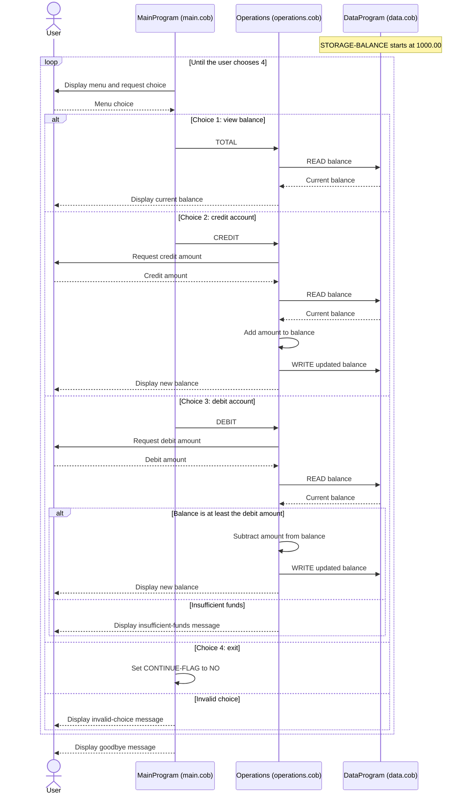

# COBOL Account Management System

This directory documents the COBOL programs under `src/cobol/`. The application is a console-based account manager with one in-memory balance.

## COBOL files

### `src/cobol/main.cob` — `MainProgram`

Entry point and menu controller.

- Displays options to view the balance, credit the account, debit the account, or exit.
- Reads a menu choice and calls `Operations` with `TOTAL `, `CREDIT`, or `DEBIT ` for the first three options.
- Continues displaying the menu until the user selects `4`; other choices display an invalid-choice message.

### `src/cobol/operations.cob` — `Operations`

Handles balance inquiries and account transactions.

- `TOTAL `: asks `DataProgram` to read the balance and displays it.
- `CREDIT`: prompts for an amount, reads the balance, adds the amount, writes the new balance, and displays it.
- `DEBIT `: prompts for an amount, reads the balance, and subtracts and writes the amount only when the balance is at least that amount. Otherwise, it displays an insufficient-funds message.

Operation names use fixed-width six-character fields, including trailing spaces in `TOTAL ` and `DEBIT `.

### `src/cobol/data.cob` — `DataProgram`

Provides in-memory balance storage for `Operations`.

- Initializes `STORAGE-BALANCE` to `1000.00`.
- On `READ`, copies the stored value into the caller's `BALANCE` field.
- On `WRITE`, copies the caller's `BALANCE` field into storage.

The value is held in COBOL `WORKING-STORAGE`; this program does not save it to a file or database.

## Account business rules

- The initial balance is `1000.00`.
- A credit adds its entered amount to the balance.
- A debit is applied only if the balance is greater than or equal to the entered amount; otherwise, the balance is unchanged and an insufficient-funds message is shown.
- The balance and transaction amount are defined as unsigned numeric fields with six integer digits and two decimal digits (`PIC 9(6)V99`).

## Student-account scope

The current programs do not identify students or maintain multiple accounts. They contain no student-specific rules for tuition, fees, enrollment, holds, or payment eligibility. The rules above apply only to the single generic balance implemented by this code.

## Node.js accounting application

The consolidated Node.js implementation is in `src/accounting/index.js`. It keeps the same menu and single in-memory account behavior and uses integer cents for balance calculations. It accepts amounts from `0.00` through `999999.99` with up to two decimal places, re-prompts for invalid input, and rejects credits that would exceed the maximum representable balance without changing the balance. These input and overflow safeguards should be confirmed with stakeholders because the COBOL programs do not define explicit handling for those cases. Run it from the application directory with `npm start`, or use the **Run COBOL-modernized Accounting App** configuration in `.vscode/launch.json`.

## Application sequence

