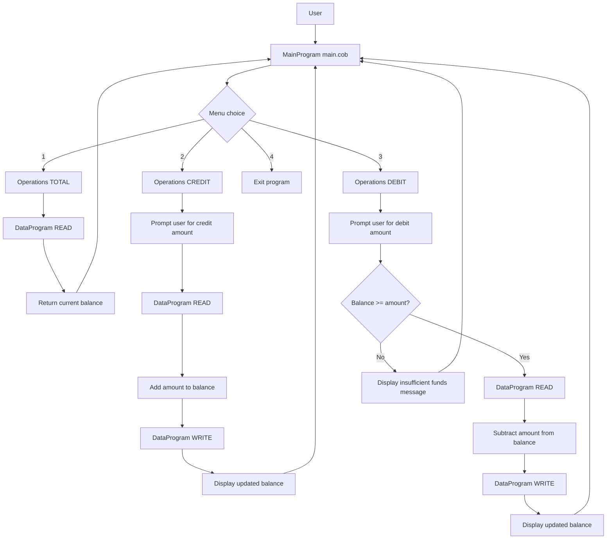

# Legacy COBOL Accounting System Overview

This repository contains a small accounting application implemented in COBOL. The code is intentionally simple and demonstrates how a legacy business app can be understood, documented, and later modernized.

## Purpose

The application supports a basic account balance workflow for an account holder:

- View the current balance
- Credit funds to the account
- Debit funds from the account
- Exit the program

The business logic is intentionally straightforward and uses a shared balance value stored in a data program.

## File-by-file breakdown

### `src/cobol/main.cob`

This is the entry point of the application and is named `MainProgram`.

Responsibilities:

- Displays a menu to the user
- Accepts the user's choice from 1 to 4
- Calls the `Operations` program based on the selected menu option
- Exits when the user chooses `4`

Key behavior:

- Menu options are:
  - `1. View Balance`
  - `2. Credit Account`
  - `3. Debit Account`
  - `4. Exit`
- The program loops until the user selects `4`
- It validates input and shows an "Invalid choice" message for anything else

### `src/cobol/operations.cob`

This file is named `Operations` and contains the business logic for account actions.

Responsibilities:

- Receives an operation type from `main.cob`
- Reads the current balance from the data program
- Performs credit or debit logic
- Writes the updated balance back to storage when needed

Key business rules:

- `TOTAL ` displays the current balance
- `CREDIT` prompts for an amount and adds it to the balance
- `DEBIT ` prompts for an amount and subtracts it only if funds are available
- If the debit amount exceeds the balance, it prints `Insufficient funds for this debit.`

Important implementation detail:

- The code uses fixed-length strings such as `PIC X(6)` for operation names (`TOTAL `, `CREDIT`, `DEBIT `)
- It relies on `CALL 'DataProgram' USING 'READ', FINAL-BALANCE` and `CALL 'DataProgram' USING 'WRITE', FINAL-BALANCE`

### `src/cobol/data.cob`

This file is named `DataProgram` and acts as the balance store.

Responsibilities:

- Keeps the current balance in memory
- Returns the balance when called with `READ`
- Saves the latest balance when called with `WRITE`

Key implementation detail:

- Storage starts at `1000.00`
- The program uses a `WORKING-STORAGE` variable named `STORAGE-BALANCE`
- `READ` copies `STORAGE-BALANCE` into the passed `BALANCE` field
- `WRITE` copies the passed `BALANCE` back into `STORAGE-BALANCE`

## Business rules summary

1. Starting balance is `1000.00`.
2. Balance can be inspected at any time.
3. Credits increase the balance.
4. Debits only happen when the balance is greater than or equal to the requested amount.
5. If a debit is too large, the transaction is rejected.
6. The program keeps running in a loop until the user exits.

## Data flow diagram

## Overall system behavior

The application is a simple console-based account manager. It is a classic example of a legacy COBOL business system where:

- the UI is procedural,
- the business logic is split across programs,
- and the balance is stored in a separate data layer.

This structure is easy to understand once the responsibilities of each file are documented, and it is a good candidate for modernization into a more current architecture such as Node.js or a web API.

## Modernization opportunities

The existing COBOL design maps naturally to a modern application:

- `main.cob` becomes the CLI/menu controller
- `operations.cob` becomes business logic functions
- `data.cob` becomes a simple repository or in-memory storage module

The main preserved rules are:

- balanced transactions,
- validation before debits,
- and persistent in-memory state during the app lifecycle.
