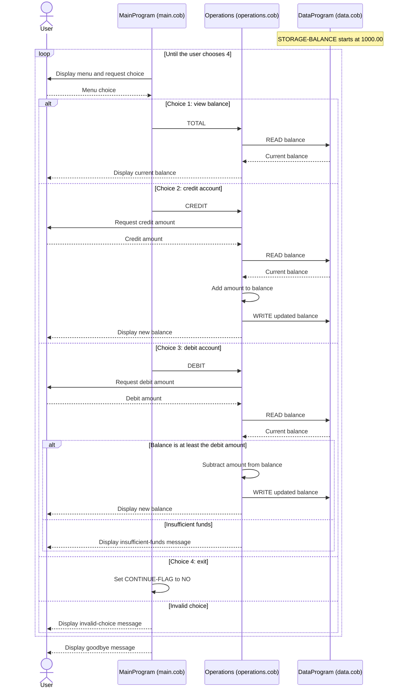

# COBOL Accounting System

This document describes the COBOL programs in `src/cobol/`, their roles in the account workflow, and the business rules visible in the source. The program implements one generic account balance; it does not identify students or define student-specific accounting rules.

## COBOL files

### `src/cobol/main.cob` — `MainProgram`

The program entry point presents a console menu and dispatches the user's selection to `Operations`:

- `1` calls `Operations` with `TOTAL ` to view the balance.
- `2` calls `Operations` with `CREDIT` to add funds.
- `3` calls `Operations` with `DEBIT ` to withdraw funds.
- `4` ends the menu loop and stops the program.

Invalid menu selections display an error message. The menu repeats until the user exits.

### `src/cobol/operations.cob` — `Operations`

Implements the account actions and coordinates balance access through `DataProgram`:

- **TOTAL:** reads and displays the current balance.
- **CREDIT:** accepts an amount, reads the balance, adds the amount, writes the result, and displays the updated balance.
- **DEBIT:** accepts an amount, reads the balance, and subtracts it only when the balance is at least the requested amount. Otherwise, it displays an insufficient-funds message and does not write an updated balance.

Amounts and balances use `PIC 9(6)V99`, allowing six whole-number digits and two decimal places. The COBOL code does not explicitly validate entered amounts or handle invalid amount input.

### `src/cobol/data.cob` — `DataProgram`

Provides the balance storage interface used by `Operations`:

- `READ` copies `STORAGE-BALANCE` into the caller's `BALANCE` field.
- `WRITE` copies the caller's `BALANCE` field into `STORAGE-BALANCE`.

The initial balance is `1000.00`. Because it is held in `WORKING-STORAGE`, it is in-memory state, not persistent file or database storage; it resets when the program is restarted.

## Core business rules

1. The account starts with a balance of `1000.00`.
2. A user can view the balance, credit the account, debit the account, or exit.
3. A credit adds the entered amount to the balance.
4. A debit is allowed only if the current balance is greater than or equal to the entered amount; an over-balance debit is rejected with an insufficient-funds message.
5. The menu continues until the user chooses to exit.

## Student-account scope and limitations

No student-account-specific rules are implemented. The source has no student identifier or separate balance per student, and it does not define tuition, fees, payment plans, refunds, scholarships, account holds, authorization, receipts, or transaction history. Those requirements should not be inferred from the generic credit/debit behavior. The current storage is one volatile balance shared by the running program; there is no durable persistence or audit trail.

## Node.js accounting application

The consolidated Node.js implementation is in `src/accounting/index.js`. It preserves the same menu and single in-memory account behavior and uses integer cents for balance calculations. It accepts amounts from `0.00` through `999999.99` with up to two decimal places, re-prompts for invalid input, and rejects credits that would exceed the maximum representable balance without changing the balance. The input and overflow safeguards should be confirmed with stakeholders because the COBOL programs do not define explicit handling for those cases.

Run the app with `npm start` or the test suite with `npm test` from `src/accounting`. The **Run COBOL-modernized Accounting App** configuration in `.vscode/launch.json` is also available for VS Code.

## Application sequence

